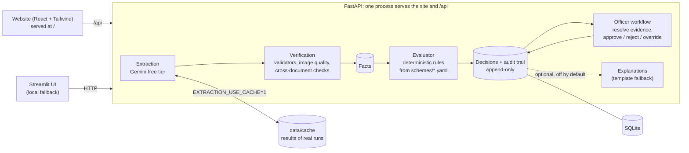

# VerifyOnce

Verify a citizen once, then reuse that verification for every scheme. Citizens upload their documents one time to build a verified profile. A vision model (Gemini, on Google's free tier) reads the fields from each document image. Deterministic checks then verify or flag every fact, and plain rules decide each application, citing the documents behind every decision. An officer reviews only the uncertain cases and signs off every one of them.

Built for Homingo Hackathon Edition 01, Automation track, problem statement B2: AI for the government office. **All people, documents and schemes in this repo are fictional.**

## Contents

1. [What it does](#what-it-does)
2. [Architecture](#architecture)
3. [Setup (Windows PowerShell)](#setup-windows-powershell)
4. [Run the app](#run-the-app)
5. [Public demo safety](#public-demo-safety)
6. [Demo day](#demo-day)
7. [How a document becomes facts](#how-a-document-becomes-facts)
8. [How decisions are made](#how-decisions-are-made)
9. [Officer rules](#officer-rules)
10. [Add a scheme](#add-a-scheme)
11. [Optional explanations](#optional-explanations)
12. [Scripts](#scripts)
13. [API](#api)
14. [Seed cases and documents](#seed-cases-and-documents)
15. [Configuration](#configuration)
16. [Tests](#tests)
17. [Limitations and responsible use](#limitations-and-responsible-use)

## What it does

A public website (React, served by the API itself) has a landing page, a citizen area, an officer console, and a How it works page. A Streamlit UI remains as a local fallback.

- **Citizen:** pick or create a profile and upload an ID card, income certificate and marksheet once (drag and drop, PNG or JPG up to 3 MB, or one of the synthetic samples). Each field is shown with its confidence, its status (verified or flagged) and the plain reason for any flag.
- **Apply:** apply for any scheme. The answer comes with a rule-by-rule table. If a scheme rejects you, the app suggests others you may qualify for, and you can apply with the same verified profile and no re-upload.
- **Officer:** work a queue of cases awaiting review. See conflicts side by side (for example the name on the ID vs on the income certificate) and the image-quality measurements, resolve each flagged fact with a typed reason, then approve, reject or override. Every step lands in an append-only audit trail.
- **What decides:** rules in YAML files decide eligibility. The model only reads documents.

## Architecture



## Setup (Windows PowerShell)

Python 3.11 or newer (developed on 3.13) and, to build the website, Node.js 20.19 or newer (free; developed on 24). From the `VerifyOnce` folder:

```powershell
py -3.13 -m venv .venv
.venv\Scripts\python.exe -m pip install -r requirements.txt
copy .env.example .env
.venv\Scripts\python.exe scripts\demo_reset.py
.venv\Scripts\python.exe scripts\preflight.py
```

After `copy`, open `.env` and paste a free key from Google AI Studio on the GEMINI_API_KEY line, right after the equals sign. `.env` is git-ignored: never commit it. Preflight reports PASS/FAIL for each check and never prints the key.

## Run the app

One command, from the `VerifyOnce` folder. It builds the website if `web\dist` is missing or out of date, then serves the website and the API together on http://127.0.0.1:8000:
```powershell
.venv\Scripts\python.exe scripts\serve.py
```
Options: `--port 8080`, `--build` (always rebuild), `--no-build`.

To build the website by hand:
```powershell
cd web; npm ci; npm run build; cd ..
```
The API answers under `/api/...` (interactive docs at `/docs`). Its original unprefixed paths still answer, for the Streamlit UI and earlier scripts.

**Website development** with live reload, in two windows: start the API (first command below), then `cd web; npm run dev` and open http://localhost:5173 (it forwards `/api` to port 8000).

**Streamlit fallback**, in two windows:
```powershell
.venv\Scripts\python.exe -m uvicorn backend.main:app --port 8000
```
```powershell
.venv\Scripts\python.exe -m streamlit run frontend\app.py --server.port 8501
```

- **Every page** shows a permanent "Synthetic data - demo only. Never upload real documents." strip (a "SYNTHETIC DATA - DEMO ONLY" banner in Streamlit). The website's footer shows the system status: API and database, model, live or cache-first extraction, thresholds, public demo on or off.
- **Display rules:** ID numbers are always masked. Every extracted fact carries a badge saying where it came from: `live` or `cache` and the model, or "seed fixture" for seeded data.
- **Errors:** failures show a short message, never a stack trace. Details stay in the server windows.

## Public demo safety

Everything is in memory and free: no external service.

- **Uploads:** PNG or JPG only, checked from the file's content, at most 3 MB (413), with a plain message for anything else (422). Bodies over the limit are refused before they are read.
- **Rate limits per IP address:** 10 uploads and 30 applications per minute (`RATE_LIMIT_UPLOADS_PER_MINUTE`, `RATE_LIMIT_APPLICATIONS_PER_MINUTE`), then 429 with `Retry-After`. Wrong PIN guesses: 5 per minute.
- **`PUBLIC_DEMO=1`:**
  - Extraction defaults to the cache (unless `EXTRACTION_USE_CACHE` is set).
  - Uploads are accepted only for the synthetic samples whose readings are cached, so no model runs for unknown files, unless the visitor enters the demo PIN.
  - Officer actions (resolve evidence, decide) need the demo PIN in the `X-Demo-Pin` header; viewing the queue and cases does not. With no `DEMO_PIN` set, officer actions are off.
- **`DEMO_PIN`** comes only from the environment. It never appears in the site's code, in `/status` or in logs, and is compared in constant time. The site keeps it in the browser tab's session storage after the visitor types it.
- **No stack traces** in any response. **CORS** is off: the site and API share one origin. `CORS_ORIGINS` adds specific origins only if ever needed. Pages carry a Content-Security-Policy (own scripts only) and refuse framing.
- The Streamlit fallback sends no PIN, so run it with `PUBLIC_DEMO` off (the default).

## Demo day

See **[DEMO.md](DEMO.md)** for the 3-minute and 60-second scripts.

```powershell
.venv\Scripts\python.exe scripts\demo_reset.py    # known state: 2 cases awaiting an officer
.venv\Scripts\python.exe scripts\preflight.py     # PASS/FAIL list
```

**If the API is slow or down on demo day, set `EXTRACTION_USE_CACHE=1`.** In `.env`, or for one window with `$env:EXTRACTION_USE_CACHE="1"`, then restart the API. Uploads of the 16 demo documents are then served from `data/cache/`, which holds results from real earlier runs (`scripts\prime_cache.py`). The UI labels them `cache`, with the model that produced them. The cache folder is git-ignored, so on a new machine run `prime_cache.py` once beforehand.

## How a document becomes facts

1. **Extraction** (`backend/extraction.py`). Gemini reads the image into a fixed JSON schema per document type. Each field has a `value` (null if unreadable, never guessed) and a `confidence` from 0 to 1. Gemini is called with `temperature` 0, and the reply is constrained to the schema, then re-checked with extra keys forbidden.
   - The prompt treats document text as untrusted data. Instructions inside a document are ignored.
   - **Retries:** a reply that breaks the schema gets one retry. Transient errors (429, 408, 5xx such as 503, timeouts) get up to 3 attempts, waiting 2s and then 5s.
   - **No fallback model:** a refusal, a blocked reply, an authentication error, or retries that run out means every field is stored empty and flagged, and an officer decides.
   - **Cache:** results are cached by file hash in `data/cache/`. Only real model replies are ever written, and an entry whose values do not match the model's recorded reply is ignored.
   - `EXTRACTION_PROVIDER=anthropic` switches to Anthropic (paid). Everything else stays the same.
2. **Verification** (`backend/verification.py`). Each fact moves from `unverified` to `verified` or `flagged`. It is flagged when:
   - its value is null;
   - a validator fails (date of birth parses and is between 1900 and today; income is a non-negative whole number; marks are 0-100; ID is 4 digits);
   - its confidence is below the cutoff (0.85);
   - its image failed the image-quality check;
   - or its name or date of birth disagrees with another document.
3. **Image quality** (`backend/image_quality.py`, no model involved).
   - **What is measured:** sharpness (the variance of a Laplacian filter) and contrast (the standard deviation of the grey levels), both at a fixed 1000-pixel width.
   - **Thresholds:** sharpness 35, contrast 15. They come from our 16 synthetic documents: the clean ones score 137-217 and 42-67, the blurry one 8.3 and 4.7.
   - **Below either threshold:** every fact from that document is flagged, whatever the model's confidence.

## How decisions are made

Plain code makes every decision (`backend/evaluator.py`). The model never decides. Precedence, first match wins:

1. **needs_human_review**: evidence a scheme needs is missing, unreadable or invalid, below the confidence cutoff, only read from a blurry or low-contrast image, or conflicting across documents.
2. **reject**: the evidence is reliable and at least one rule fails.
3. **approve**: the evidence is reliable and every rule passes.

Review wins over reject on purpose: a rejection based on a misread document would deny a benefit someone qualifies for. Every rule is still evaluated and recorded as pass, fail or unresolved.

- **Covered readings:** a low-confidence or low-quality reading that agrees with a confident reading from a good document is covered by it. A disagreeing one is still a conflict.
- **Name matching:** names match across case, spacing, initials and word order ("Ravi K. Patil" = "Ravi Patil"). A different spelling is a real conflict ("Ishan Rao" vs "Ishan Rau").
- **Records:** facts keep every observation. Decisions are immutable (both the ORM and a SQLite trigger refuse updates). Only the last 4 digits of an ID are ever stored.

| Scheme (`schemes/*.yaml`) | Rules | Identity evidence |
|---|---|---|
| State Student Scholarship | income ≤ ₹3,00,000 and marks ≥ 60% | name, date of birth, ID last 4 |
| Income-Based Fee Waiver | income ≤ ₹4,50,000 | name, date of birth, ID last 4 |
| Merit Book Grant | marks ≥ 75% and income ≤ ₹5,00,000 | name, date of birth, ID last 4 |

## Officer rules

`backend/officer.py`:

- **A review case ends only with an officer decision.** It stays in the queue as *awaiting officer decision* until an officer approves, rejects or overrides. Nothing automatic closes it, and the citizen cannot resubmit over it.
- **Resolving evidence** (confirm or reject one flagged fact) needs a typed reason. It records an audit event and shows the re-evaluated result as **Suggested: <verdict>**, but records no decision.
- **Approve** is blocked while flagged evidence is unresolved, and needs the suggested verdict to be approve.
- **Override** and **reject** need a typed reason.
- **Every officer decision** creates a new Decision and an AuditEvent linked to the original decision. Decisions are superseded, never edited.
- **There is no login yet.** The officer name comes from the sidebar and is recorded as `officer:<name>`.

## Add a scheme

Add one YAML file to `schemes/`, named after its id. No code changes. The Merit Book Grant was added this way:

```yaml
id: merit_book_grant
name: Merit Book Grant
ruleset_version: "2026.1"
description: A grant for textbooks for students who scored at least 75% and whose family income is at most 500000 INR.
required_fields: [name, date_of_birth, id_last4]   # identity evidence checked first
rules:
  - {id: minimum_marks, field: marks_percent, op: gte, value: 75, description: Marks must be at least 75%.}
  - {id: income_limit, field: annual_income_inr, op: lte, value: 500000, description: Income must be at most 500000 INR.}
```

- **Operators:** `gte`, `lte`, `eq`, `in`, `exists`.
- **Fields:** `name`, `date_of_birth`, `state`, `annual_income_inr`, `marks_percent`, `id_last4`.
- **Loading:** restart the API to load a new file. A malformed file is refused at startup with a clear error.

## Optional explanations

Off by default (`EXPLANATIONS_ENABLED=0`), so the demo makes no extra API calls.

- **What you get:** with `EXPLANATIONS_ENABLED=1`, each recorded decision gets a 2-3 sentence explanation for the citizen and a short brief for the officer, written by Gemini.
- **What Gemini sees:** only structured decision data (verdict, rule outcomes, flag types and their numbers). Never document text or names.
- **Validation:** the text may not mention a rule ID, number or name that is not in the decision, and must state the same outcome as the verdict.
- **Fallback:** on any API error, a 429 or 503 after retries, or a failed validation, a template explanation is used instead.
- **Storage:** stored on the decision and labelled "generated" (with the model) or "template". It never makes or changes a verdict.

## Scripts

| Command | What it does |
|---|---|
| `scripts\serve.py` | One command: builds the website if needed, then serves the website and the API on port 8000. |
| `scripts\demo_reset.py` | Wipes and rebuilds the demo database: five seed profiles, plus two scholarship cases awaiting an officer (`seed-name-mismatch`, `seed-low-confidence`). `--clean` leaves no applications. `seed-below-marks` is kept application-free for the live demo moment. Same result every run. |
| `scripts\preflight.py` | PASS/FAIL: `.env` exists, key set (never printed), API `/health`, database (and schema version), demo cache complete, live or cached mode. |
| `scripts\prime_cache.py` | Runs real extraction once per demo document and caches the result. Skips cached files, so it is safe to re-run, and lists failures to retry. |
| `scripts\metrics.py` | Time-to-verdict per seed case and scheme, the automatic vs review share, and review cases closed by an officer in the demo database. Only measured numbers. |
| `scripts\list_models.py` | Gemini models your key can use that accept images (names only). |
| `scripts\live_check.py` | Real extraction of the clean, blurry and (`--injection`) prompt-injection marksheets, or a whole case with `--profile <case>`. |
| `scripts\run_seed_cases.py` | Every seed profile through both original schemes, expected vs actual. |
| `scripts\make_documents.py` | Regenerates the synthetic document images and manifests. |
| `python -m backend.image_quality` | Sharpness and contrast of every synthetic document. |

## API

Every path below is served under `/api` (for example `GET /api/status`). The unprefixed paths shown here still answer too, hidden from `/docs`.

| Method | Path | Returns |
|---|---|---|
| `GET` | `/health` | Liveness, database check (reports an outdated schema), profile count |
| `GET` | `/status` | Provider and model, live or cached extraction, whether a key is set (never the key), cutoff, explanations on or off, public-demo flags, upload limits (never the PIN) |
| `GET` | `/demo-documents`, `/demo-documents/{case}/{file}` | The 16 synthetic sample documents, whether each has a cached reading, and the images |
| `POST` | `/demo-pin` | Checks the `X-Demo-Pin` header (rate-limited) |
| `GET` | `/profiles`, `/profiles/{id}` | Profiles; documents with image quality, extraction details and facts with checks and flag reasons |
| `POST` | `/profiles/{id}/documents` | Multipart `document_type` and `file` (PNG or JPG, at most 3 MB). Extracts, validates, cross-checks; returns facts, statuses and `extraction_source`. Rate-limited. |
| `POST` | `/profiles/{id}/applications` | `{"scheme_id": ...}`. New decision with rule outcomes, source facts, reasons and `possible_schemes`. Refused (409) while awaiting or after an officer decision. |
| `GET` | `/profiles/{id}/applications` | The profile's applications with status and latest decision |
| `GET` | `/officer/queue` | Applications with status (awaiting officer decision first) and the suggested verdict. `?verdict=` filters. |
| `GET` | `/officer/cases/{id}` | Case detail: decision on record, suggestion, conflicts side by side, unresolved flags, image quality, approval blockers |
| `POST` | `/officer/cases/{id}/evidence` | `{fact_id, resolution, reason, officer}`. Returns the new suggestion; records no decision. Needs the demo PIN when `PUBLIC_DEMO=1`. |
| `POST` | `/officer/cases/{id}/decision` | `{action, verdict, reason, officer}`, where `action` is approve, reject or override. New officer decision. Needs the demo PIN when `PUBLIC_DEMO=1`. |
| `GET` | `/applications/{id}/audit` | Plain-language audit history with actor and timestamp |

## Seed cases and documents

`backend/seed.py` is the single source of truth. `scripts\make_documents.py` renders each seed document as a watermarked image in `data/documents/<case>/`, with test-only manifests. Seeded profiles load these values directly, so no extraction runs for them; their facts show "seed fixture".

| Profile | Scholarship | Fee waiver | What it shows |
|---|---|---|---|
| `seed-approve` | approve | approve | Name variants with initials still match |
| `seed-reject-income` | reject | reject | Income above both limits |
| `seed-below-marks` | reject | approve | Fails on marks only (52%); the fee waiver is offered with no re-upload |
| `seed-name-mismatch` | review | review | Income certificate says "Ishan Rau", the others "Ishan Rao" |
| `seed-low-confidence` | review | approve | Blurry, low-contrast marksheet; the fee waiver needs no marks |

`data/documents/prompt-injection/` holds the below-marks marksheet with a hidden instruction to AI systems, for the injection tests.

## Configuration

`.env` (copy from `.env.example`; a shell variable such as `$env:NAME="value"` overrides it):

| Variable | Default | Meaning |
|---|---|---|
| `GEMINI_API_KEY` | (none) | Free key from Google AI Studio. Without it, uploads go to officer review. |
| `GEMINI_MODEL` | `gemini-3.5-flash-lite` | `scripts\list_models.py` lists the models your key can use |
| `EXTRACTION_USE_CACHE` | off | `1` serves the demo documents from `data/cache/` (results of real runs) |
| `EXPLANATIONS_ENABLED` | `0` | `1` adds generated explanations (extra API calls) |
| `EXTRACTION_PROVIDER` | `gemini` | `anthropic` switches to Anthropic's paid API (`ANTHROPIC_API_KEY`, `ANTHROPIC_MODEL`) |
| `VERIFY_ONCE_DB` | `data/verifyonce.db` | SQLite path or SQLAlchemy URL |
| `VERIFY_ONCE_CONFIDENCE_CUTOFF` | `0.85` | Models report coarse confidences (0.8, 0.9, 1.0); a bare 0.8 does not pass |
| `PUBLIC_DEMO` | `0` | `1` for a public website: cache by default, sample uploads only without the PIN, officer actions need the PIN |
| `DEMO_PIN` | (none) | The demo PIN. Set it in the environment only; it is never shown |
| `CORS_ORIGINS` | (none) | Comma-separated extra origins allowed to call the API. Empty means same origin only |
| `RATE_LIMIT_UPLOADS_PER_MINUTE` | `10` | Per IP address |
| `RATE_LIMIT_APPLICATIONS_PER_MINUTE` | `30` | Per IP address |
| `API_BASE_URL` | `http://127.0.0.1:8000` | Where the Streamlit UI finds the API |

There are no database migrations. After pulling a change to the data model, run `scripts\demo_reset.py`; preflight reports an outdated database.

## Tests

```powershell
.venv\Scripts\python.exe -m pytest                           # offline: the model is mocked
.venv\Scripts\python.exe -m pytest -m live --run-live -s     # opt-in: 3 real Gemini calls
```

Browser smoke test (opt-in, free). It drives the Edge or Chrome already installed on Windows, so there is no browser download. It loads every page, checks the phone layout, and runs the reject-then-fee-waiver flow:
```powershell
.venv\Scripts\python.exe -m pip install -r requirements-e2e.txt
.venv\Scripts\python.exe -m pytest -m e2e --run-e2e
```
Build the website first (`cd web; npm ci; npm run build; cd ..`). `cd web; npm run typecheck` checks the TypeScript.

## Limitations and responsible use

- **Synthetic data only.** Every person, document and scheme here is fictional. **Never upload real personal data or real identity documents.**
- **Human review for uncertain cases.** Missing, unreadable, low-confidence, blurry or conflicting evidence always goes to an officer. The system never rejects on evidence it does not trust.
- **Deterministic rules decide eligibility.** The model only reads fields from documents. Rules in YAML files decide every verdict, and the optional explanations never change one.
- **Officer sign-off ends every review case.** A case sent to review closes only with an officer's approve, reject or override, recorded with a typed reason in an append-only audit trail.
- **Image-quality thresholds are tuned on synthetic images.** Real phone photos and scans may need the thresholds retuned.
- **Model confidence is not trusted on its own.** In testing, the model gave the same 0.8 to correct and incorrect readings of a blurry scan. Deterministic checks (validators, image quality, cross-document comparison) decide what is flagged.
- **A free-tier model's availability and limits can change.** Models get overloaded (503), quotas run out (429), and models are retired or closed to new accounts. The app retries, then sends documents to review. Demo documents can be served from a cache of real runs.
- **Hidden instructions in documents.** The prompt ignores them and the schema refuses extra fields. A model that obeyed an instruction while keeping to the schema would not be caught by the schema alone.
- **No authentication.** Officer identity is a typed name; on a public demo, officer actions need a shared demo PIN. Rate limits are per server process and reset on restart. This is a demo, not a production system.
